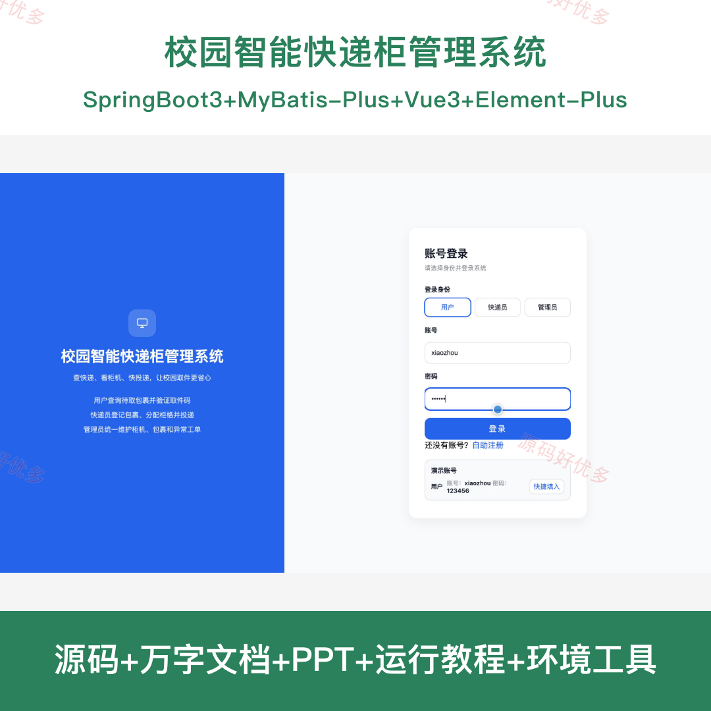
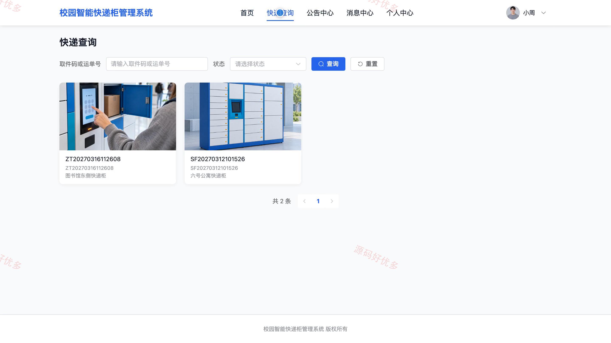
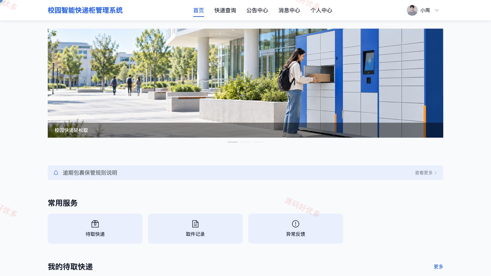
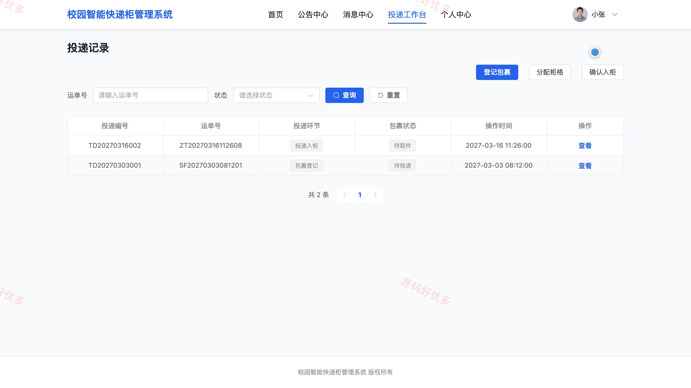
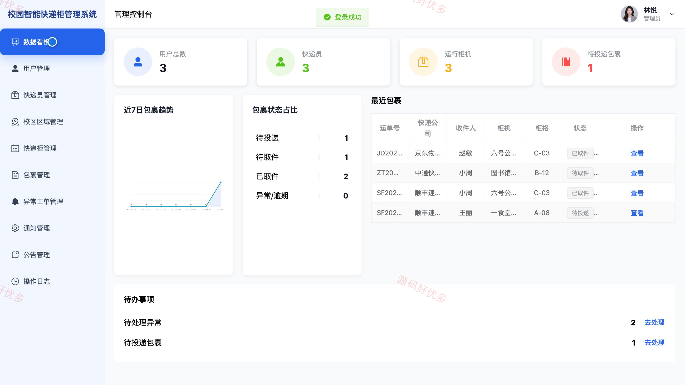
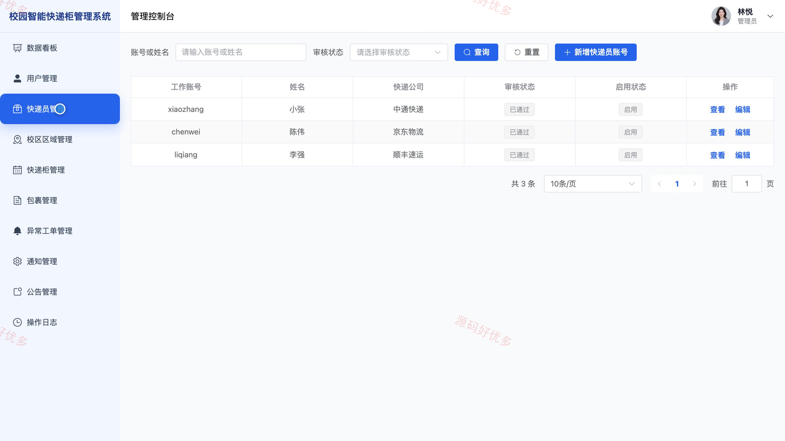
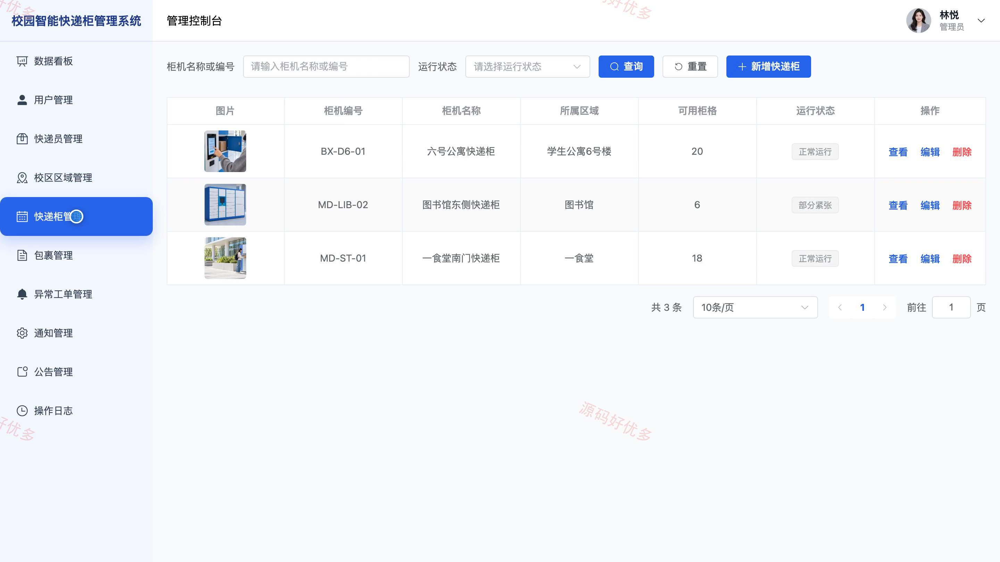
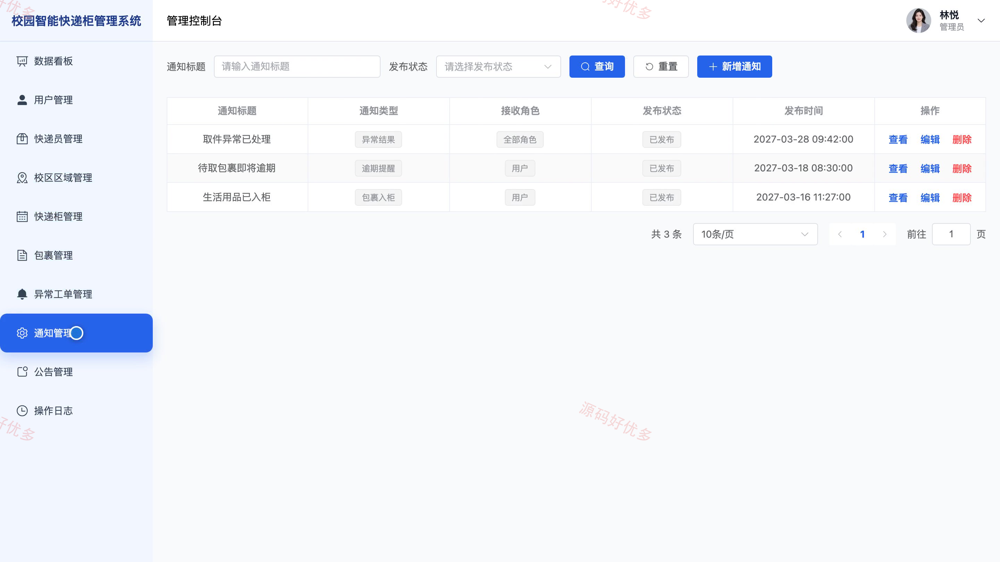

## 源码问题查看主页咨询

### 一、关键词
校园快递柜、智能取件柜、快递自提、校园包裹代收、柜机投递

### 二、作品包含
源码+数据库+万字设计文档+PPT+全套环境和工具资源+本地部署教程

### 三、项目技术
前端技术： Html、Css、Js、Vue3.4、Element-Plus
后端技术：Java、SpringBoot3.2.0、MyBatis-Plus

### 四、运行环境要求
开发工具：IDEA/eclipse + VSCODE

数据库：MySQL5.7+（共14张表）

数据库管理工具：Navicat10以上版本

环境配置软件： JDK17 + Maven3.6

前端Nodejs：16+

浏览器：谷歌浏览器

### 五、项目介绍
项目编号：bs139A

本系统面向校园用户、快递员和管理员，提供包裹入柜、取件码验证、异常反馈及快递柜资源管理，支持校园包裹投递与自助取件的日常协作。

角色：用户、快递员、管理员

用户功能：账号登录、查询待取包裹和柜机位置、验证取件码并开柜、查看取件与逾期记录、提交异常反馈、查看入柜和逾期通知、查看校园公告、维护个人资料和密码。

快递员功能：工作账号登录、查询柜机和可用柜格、登记包裹和收件人、分配适用柜格、确认入柜并通知收件人、查询投递记录、上报投递与柜格异常、维护个人资料和密码。

管理员功能：查看投递取件与柜格统计、管理用户与快递员、维护校区区域与快递柜、管理包裹和投递记录、处理异常工单、管理业务通知、发布校园公告、查看操作日志。

### 六、运行截图

